# HLD Walkthrough: URL Shortener — Full Depth Version

Same question-driven structure as before, now with the actual substance restored: worked scale math (each number chained from the last), a decision rule per option instead of a vague pro/con, and the ID-generation choice explicitly cross-linked to the sharding decision later on.

```mermaid
flowchart TD
    Root["Design URL<br/>Shortener?"]

    %% ── Functional ──
    Root --> QDo["What can<br/>users DO?"]
    QDo --> Shorten["Shorten a<br/>long URL?"]
    Shorten -->|yes| APIShorten["POST<br/>/api/urls/shorten<br/>CREATE"]
    QDo --> Open["Open a<br/>short link?"]
    Open -->|yes| APIOpen["GET /{short}<br/>-&gt; 302<br/>READ, hot path"]
    QDo --> Track["Count<br/>clicks?"]
    Track -->|yes| APITrack["Async event,<br/>off redirect path<br/>UPDATE"]
    Track -->|no| OOS["Out of scope,<br/>hook stays open<br/>for later"]

    %% ── Non-functional ──
    Root --> QQual["What QUALITY<br/>is needed?"]
    QQual --> QInstant["Must feel<br/>instant?"]
    QInstant -->|yes| ALatency["Low latency<br/>single-digit ms<br/>read-through cache"]
    QQual --> QBusy["Up under<br/>high traffic?"]
    QBusy -->|yes| AAvail["High availability<br/>stateless + LB<br/>no single point"]
    QQual --> QKeep["Links live<br/>for years?"]
    QKeep -->|yes| ADur["Durability<br/>replicated store"]
    QQual --> QOne["One short -&gt;<br/>one long, always?"]
    QOne -->|yes| AUniq["Global uniqueness<br/>rules out naive<br/>random IDs"]

    %% ── Scale, chained math ──
    Root --> QScale["At WHAT<br/>scale?"]
    QScale --> SUsers["Daily users?<br/>assume 100M DAU"]
    SUsers --> SRatio["Reads per write?<br/>100 : 1<br/>optimize reads"]
    SRatio --> SWrites["New URLs/day?<br/>100M / 100<br/>= 1M writes/day"]
    SWrites --> SBytes["Size per entry?<br/>short+long+meta<br/>≈ 500 bytes"]
    SBytes --> SRet["Retention?<br/>5 years"]
    SRet --> SStore["Total storage:<br/>1M x 500B x 365<br/>x 5 ≈ 0.9 TB"]

    %% ── Data model ──
    Root --> QData["What DATA<br/>to store?"]
    QData --> DMap["URLMapping table<br/>short_url PK,<br/>original_url"]
    QData --> DClick["Analytics table<br/>short_url,<br/>click_count"]

    %% ── APIs ──
    Root --> QApi["What<br/>APIs?"]
    QApi --> AiPost["POST /shorten<br/>{longUrl} -&gt;<br/>{shortUrl}"]
    QApi --> AiGet["GET /{short}<br/>302 + Location<br/>emits async event"]
    QApi --> AiNo["Analytics API?<br/>NO — internal<br/>event stream only"]

    %% ── Traffic flow ──
    Root --> QFlow["How does<br/>TRAFFIC flow?"]
    QFlow --> FWrite["Write: LB -&gt;<br/>Shortening Svc<br/>-&gt; mapping store"]
    QFlow --> FRead["Read: LB -&gt;<br/>cache check<br/>-&gt; DB on miss"]
    QFlow --> FAnalytics["Analytics: event<br/>-&gt; Redis counter<br/>-&gt; batched flush"]

    %% ── ID generation, full depth ──
    Root --> QId["How to mint<br/>SHORT IDs?<br/>needs unique + short"]

    QId --> IdHash["Hash the<br/>long URL?"]
    IdHash --> IdHashUse["USE: want free<br/>dedup, no coordinator<br/>AVOID: high write scale"]
    IdHash --> IdHashTrade["Truncating causes<br/>real collisions —<br/>needs retry-with-salt"]

    QId --> IdUuid["Random<br/>UUID?"]
    IdUuid --> IdUuidUse["USE: internal keys,<br/>zero coordination<br/>AVOID: public short code"]
    IdUuid --> IdUuidTrade["36 chars raw —<br/>truncating it back<br/>reintroduces collisions"]

    QId --> IdSnow["Snowflake<br/>IDs?"]
    IdSnow --> IdSnowUse["USE: need ordering,<br/>can run a coordinator<br/>AVOID: want zero ops"]
    IdSnow --> IdSnowTrade["Sortable, high<br/>throughput, but<br/>clock-skew risk"]

    QId --> IdMachine["★ CHOSEN:<br/>Machine ID + Seq"]
    IdMachine --> IdMachineUse["USE: write paths<br/>must stay independent<br/>— scale by adding boxes"]
    IdMachine --> IdMachineTrade["Short, unique,<br/>zero collision retries<br/>needs seq persistence"]

    %% ── Encoding, with real math ──
    Root --> QEnc["How to<br/>ENCODE the IDs?"]
    QEnc --> EncHex["Base16 hex?<br/>0-9a-f only<br/>7 chars ≈ 268M space<br/>too small for scale"]
    QEnc --> Enc64["Base64?<br/>shortest per char<br/>but +/= break URLs<br/>needs url-safe variant"]
    QEnc --> Enc62["★ Base62 chosen<br/>0-9A-Za-z<br/>62^7 ≈ 3.5T space<br/>covers years of growth"]

    %% ── Scaling writes, cross-linked to the ID choice ──
    Root --> QGrow["How to SCALE<br/>writes?"]
    QGrow --> GShard["Machine prefix<br/>= shard key<br/>(same prefix from<br/>the CHOSEN ID above)"]
    IdMachine -.->|feeds directly into| GShard
    GShard --> GRead["Cache miss routes<br/>straight to the<br/>right shard, no scatter"]
    GShard --> GPregen["Pre-generate ID<br/>batches? Usually<br/>unnecessary here —<br/>prefix already decouples writers"]
```

---

## What's actually different this time

**The scale section is a chain, not six separate facts.** Each node's math consumes the number handed down from the one before it — 100M DAU → 100:1 ratio → 1M writes/day → 500 bytes/entry → 5 years → ≈0.9 TB — so the diagram itself shows the derivation, not just the destination. Reading it top to bottom is genuinely walking through the estimation the way you'd have to do it live.

**Every ID option carries a decision rule, both directions.** "USE when X, AVOID when Y" instead of a bare description — a rule you could actually apply to a different problem later, not just a fact about this one.

**Encoding keeps the actual numbers.** Base16's rejection isn't "not compact enough" — it's `7 chars ≈ 268M space`, put directly next to Base62's `62^7 ≈ 3.5T space`, so the gap between the two options is a comparison you can see, not one you have to take on faith.

**The ID decision and the sharding decision are drawn as connected, not two islands.** The dotted arrow from `★ CHOSEN: Machine ID + Seq` into `Machine prefix = shard key` is the actual point — the same prefix that makes the ID short also becomes the thing that routes writes to the correct shard later. That's one decision doing two jobs, and the diagram now says so instead of leaving it implicit.

---

*Same URL shortener problem as the earlier two versions in this series — this one restores the worked-math depth and cross-linking that a pure "short label, avoid clipping" pass had accidentally stripped out.*
