# HLD Walkthrough: URL Shortener — Question-Driven Version

Rebuilt to match the actual HLD discovery process — starting from the problem, branching into open questions, resolving each into a concrete answer. Not an architecture diagram of a decision already made; the tree *is* the reasoning.

```mermaid
flowchart TD
    Root["Design URL<br/>Shortener?"]

    Root --> Q1["What can<br/>users DO?"]
    Root --> Q2["What QUALITY<br/>is needed?"]
    Root --> Q3["At WHAT<br/>scale?"]
    Root --> Q4["What DATA<br/>to store?"]
    Root --> Q5["What<br/>APIs?"]
    Root --> Q6["How does<br/>TRAFFIC flow?"]
    Root --> Q7["How to mint<br/>SHORT IDs?"]
    Root --> Q8["How to<br/>ENCODE the IDs?"]

    Q1 --> U1["Shorten a<br/>long URL?"]
    Q1 --> U2["Open a<br/>short link?"]
    Q1 --> U3["Count<br/>clicks?"]

    U1 -->|yes| API1["POST<br/>/api/shorten"]
    U2 -->|yes| API2["GET /{short}<br/>-&gt; 302"]
    U3 -->|yes| API3["Async click<br/>counter"]
    U3 -->|no| OOS["Out of scope<br/>for v1"]

    Q2 --> A2["Low-latency<br/>redirect (P99)<br/>availability &gt; consistency"]

    Q3 --> A3["Read-heavy,<br/>100:1+ read:write"]

    Q4 --> A4["short_code -&gt;<br/>long_url mapping,<br/>key-value shape"]

    Q5 --> A5["POST /shorten,<br/>GET /{code}"]

    Q6 --> A6["LB -&gt; cache check<br/>-&gt; DB on miss<br/>-&gt; async analytics"]

    Q8 --> A8["Base62 encoding<br/>(a-z, A-Z, 0-9)<br/>compact + URL-safe"]

    Q7 --> O1["Hash the<br/>long URL?"]
    Q7 --> O2["Random<br/>UUID?"]
    Q7 --> O3["Snowflake<br/>IDs?"]
    Q7 --> O4["★ CHOSEN:<br/>Pre-gen key pool"]

    O1 --> O1U["When to use:<br/>want free dedup,<br/>determinism matters"]
    O1 --> O1T["Tradeoff:<br/>truncated hash collides,<br/>needs retry logic"]

    O2 --> O2U["When to use:<br/>quick prototype,<br/>low traffic"]
    O2 --> O2T["Tradeoff:<br/>36 chars raw —<br/>not actually short"]

    O3 --> O3U["When to use:<br/>huge multi-region<br/>write volume"]
    O3 --> O3T["Tradeoff:<br/>extra service to run,<br/>real ops overhead"]

    O4 --> O4U["When to use:<br/>default choice —<br/>fast write, no collision"]
    O4 --> O4T["Tradeoff:<br/>needs a background<br/>refill job"]
```

---

## What changed, and why it matters

**The root question stays a question, not a component.** "Design URL Shortener?" branches directly into the things you'd actually need to nail down before drawing a single box — what users can do, what quality bar matters, what scale, what data, what APIs, how traffic moves, and the two genuinely contested decisions (ID minting, encoding). Architecture components (load balancer, cache, DB) only show up as **answers** to those questions, inside the leaf nodes — they're the output of the reasoning, not the starting point of the diagram.

**Yes/no branches record scope decisions explicitly.** "Count clicks?" resolving to both a "yes → async click counter" and a "no → out of scope for v1" is the same discipline as the reference tool's red "no" edges — a scoping decision that got made and recorded, not silently dropped because it wasn't the interesting part of the problem.

**The ID-minting decision keeps "when to use" and "tradeoff" as separate children, not one crammed label.** Each option (hash, random UUID, Snowflake, pre-generated pool) branches into two distinct leaf nodes instead of one node trying to hold both — matching the reference photo's structure exactly, and it reads better for the same reason: a "when would I actually reach for this" question and a "what does it cost me" question are genuinely different questions, and cramming both into one diamond makes you skim past one of them.

**The chosen option is marked, not just placed last.** `★ CHOSEN: Pre-gen key pool` is visually distinct from its three siblings sitting right next to it in the same row — the diagram itself states the decision, rather than making a reader infer "I guess the last one in the list is the answer" from position alone.

---

*Same URL shortener problem as the earlier walkthrough in this series — this version restructures it around the question-driven HLD discovery process instead of a pre-decided architecture diagram.*
