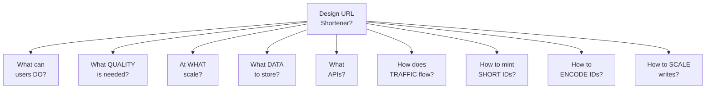
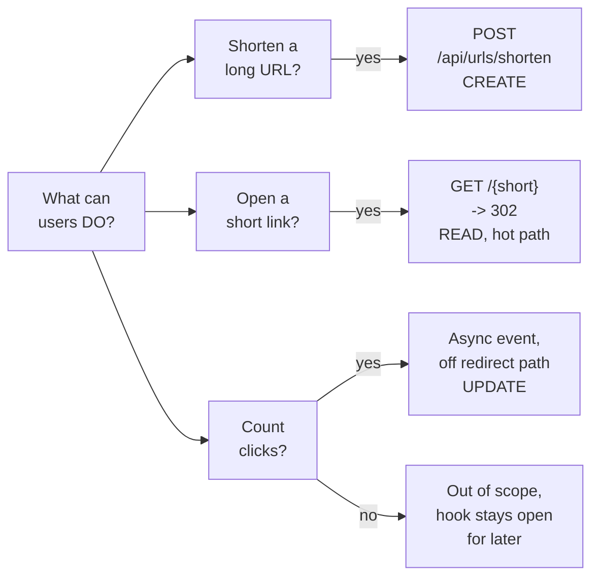
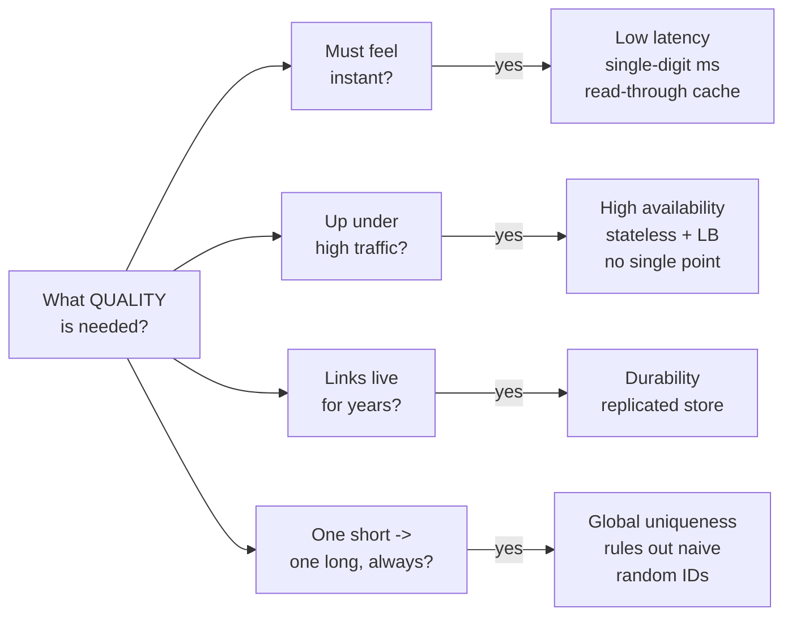
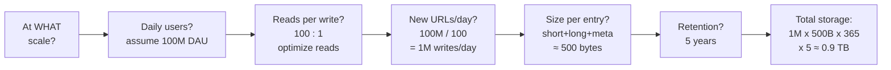
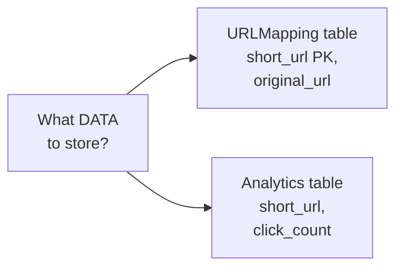
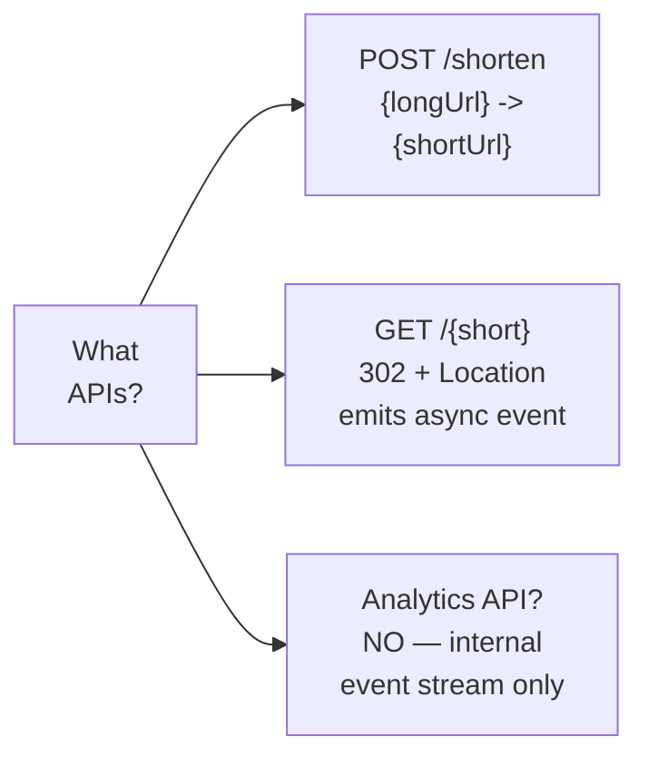
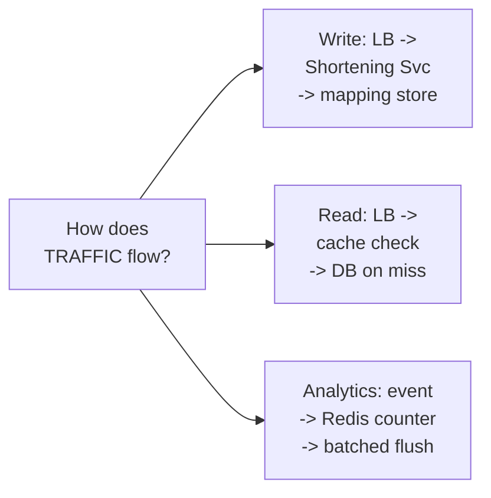
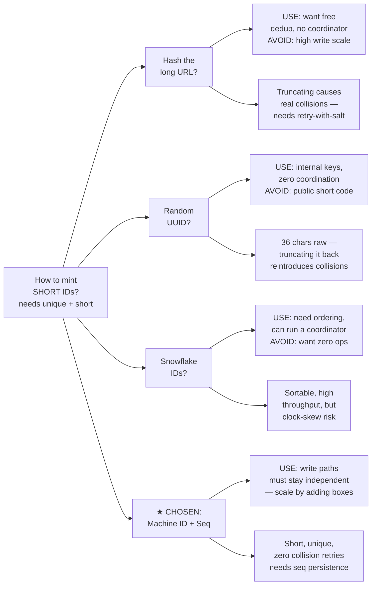
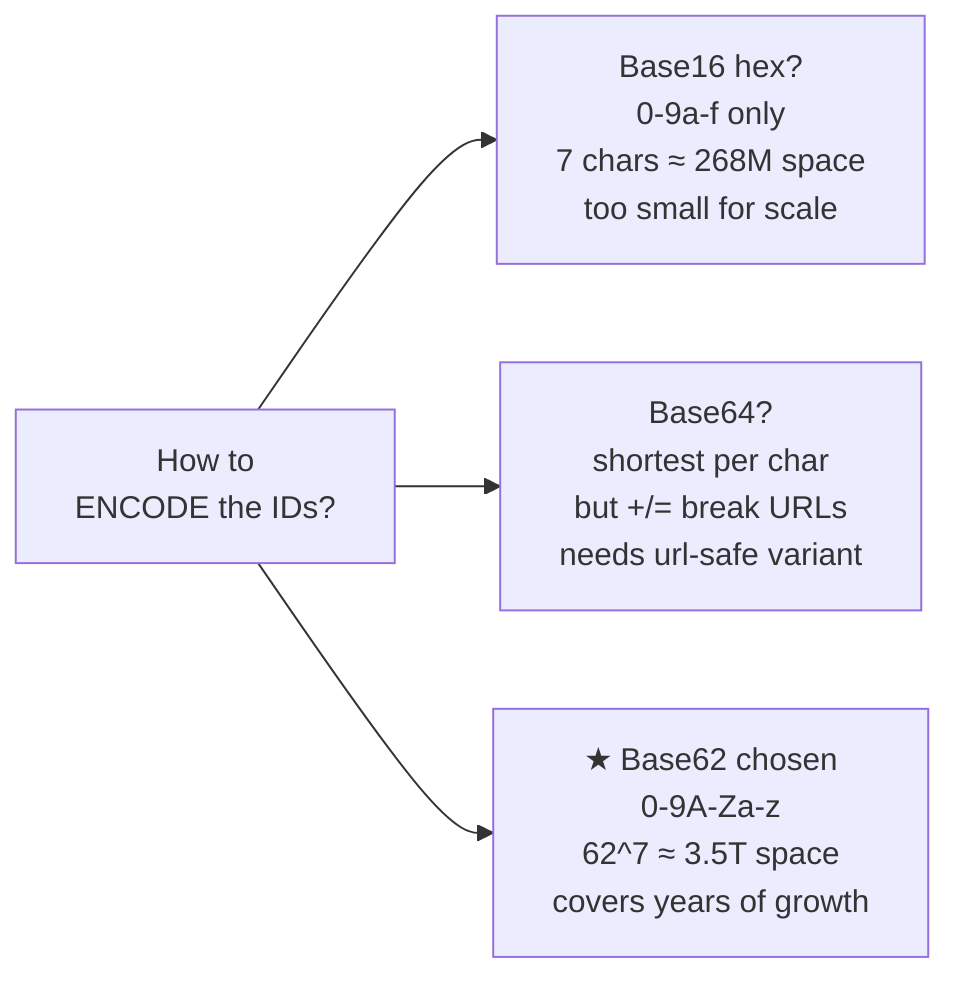
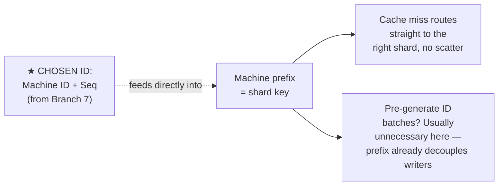

# HLD Walkthrough: URL Shortener — Full Depth, Split for Readability

Same content as the full-depth version, split into one overview plus separate diagrams per branch — same fix as the Android mindmap. Each diagram below renders at full width on its own, so nothing shrinks and nothing needs zooming.

## Overview

---

## Branch 1: What can users DO?

---

## Branch 2: What QUALITY is needed?

---

## Branch 3: At WHAT scale? (worked math, chained)

---

## Branch 4: What DATA to store?

---

## Branch 5: What APIs?

---

## Branch 6: How does TRAFFIC flow?

---

## Branch 7: How to mint SHORT IDs?

---

## Branch 8: How to ENCODE the IDs?

---

## Branch 9: How to SCALE writes? (cross-linked to Branch 7's choice)

---

## What's preserved from the full-depth version

Nothing was cut to make this split — same worked math in Branch 3 (100M DAU chained all the way to ≈0.9 TB), same two-sided decision rules in Branch 7, same real numbers in Branch 8 (268M vs. 3.5T), same explicit cross-link in Branch 9 back to the chosen ID strategy. The only change is structural: nine smaller diagrams instead of one tall one, so each renders at a readable size without needing to zoom at all.

---

*Same URL shortener problem as the other versions in this series — this is the full-depth content, restructured for actual readability instead of forcing one oversized diagram.*
