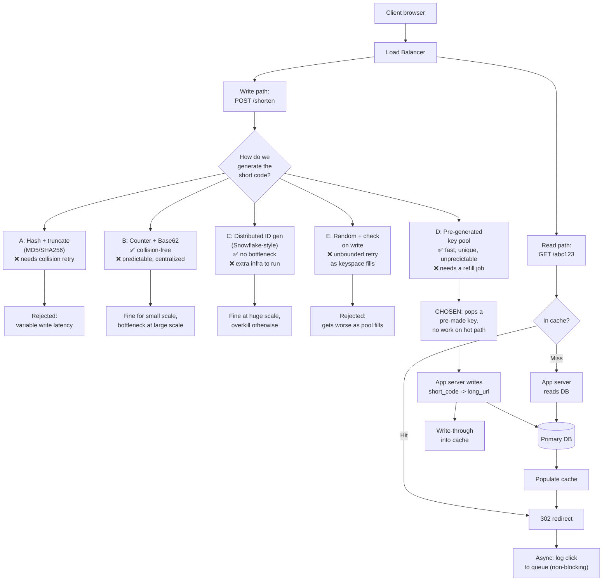

# HLD Problem Walkthrough: URL Shortener

First in a series covering the classic system design interview problems (URL shortener, YouTube, Twitter, and more to follow) — full architecture, plus every real decision point spelled out with its alternatives and why one usually wins.

---

## 1. Requirements, First

**Functional:** given a long URL, return a short one; given a short URL, redirect to the original; optionally support custom aliases and expiration.

**Non-functional:** this system is **read-heavy** by a huge margin — redirects vastly outnumber new-URL creations in any real product (think 100:1 or higher) — and redirect **latency matters enormously**, since it sits directly in a user's click path. Availability matters more than strong consistency here: a slightly stale click-count is fine, a broken redirect is not.

---

## The Whole Design, One Flowchart

---

## Why Option D wins, in one paragraph

Option D (pre-generated key pool) is the only branch that's simultaneously collision-free, unpredictable, and fast on the write path — it gets there by moving the expensive part (generating and checking uniqueness) into a background job, off the request path entirely, so a write is just "pop a ready-made key" instead of "hash, hope, and maybe retry" (Option A/E) or "wait on one shared counter" (Option B). Option B is the right call when the system is small enough that a centralized counter's bottleneck genuinely won't be hit for a long time — a completely fine answer as long as you name that tradeoff instead of presenting it as free. Option C is the right call once you're at a scale where even a key-pool service becomes the next bottleneck — reaching for it before that scale is established is over-engineering, the same caution the HLD cheat sheet raises about sharding or microservices too early.

---

## 6. Rounding Out the Rest of the Design

A few other decisions worth having answers for, briefly, since they come up as natural follow-ups:

- **Custom aliases:** bypass the ID generator entirely, just check the requested alias isn't already taken (a simple uniqueness check against the DB, on a path that's expected to be occasionally slower since it's not the hot path).
- **Expiration:** store a `expires_at` column, either check it on read (adds a comparison to every redirect) or run a periodic cleanup job that removes expired rows and evicts them from cache — the periodic-cleanup approach keeps the hot read path from paying an extra check on every single request.
- **Database choice:** this is a simple key-value lookup (`short_code -> long_url`) with no relational structure needed — a case where a key-value store (Redis as the cache, DynamoDB or Cassandra as the durable store) genuinely fits better than forcing a relational schema, echoing the HLD cheat sheet's database-choice section.
- **Analytics at scale:** click counts don't need to be exactly right in real time — an eventually-consistent counter (incremented asynchronously, batched, or approximated) is the right call here, not a synchronous write on every redirect.

---

*First in the HLD problem-walkthrough series — same format planned for YouTube, Twitter, and the rest of the classic interview problems: full architecture, plus every genuinely contested decision point named explicitly with its real tradeoffs, not just the "correct" answer presented as obvious.*
