# The ML System Design Flowchart: Decision Tree for Interviews

Same idea as the HLD flowchart — this is the order you'd actually walk through an "ML system design" interview prompt ("design a recommendation system," "design fraud detection," "design a search ranking system"), not a concept map. Each answer narrows the ones after it.

```mermaid
flowchart TD
    Start["Given an ML<br/>system design<br/>prompt"] --> Q1["Step 1: Clarify<br/>the problem<br/>BEFORE the model"]

    Q1 --> Q1a{"What action does<br/>the prediction<br/>drive?"}
    Q1a --> Q1b["Step 2: Separate<br/>business metric<br/>from ML proxy metric"]

    Q1b --> Q2{"Step 3:<br/>Real-time or<br/>batch prediction?"}
    Q2 -->|"Real-time<br/>(fraud, ads)"| RT["Tight latency.<br/>Low-latency<br/>serving path."]
    Q2 -->|"Batch<br/>(nightly recs)"| BATCH["Loose latency.<br/>Precompute on<br/>a schedule."]

    RT --> Q3
    BATCH --> Q3

    Q3{"Step 4: What<br/>SHAPE is the<br/>problem?"}
    Q3 -->|"Category"| CLASS["Classification"]
    Q3 -->|"Number"| REG["Regression"]
    Q3 -->|"Order a list"| RANK["Ranking"]
    Q3 -->|"Find similar<br/>items"| RETRIEVE["Retrieval /<br/>similarity search"]
    Q3 -->|"Rare events"| ANOM["Anomaly<br/>detection"]

    CLASS --> Q4
    REG --> Q4
    RANK --> Q4S{"Candidate pool<br/>in the millions?"}
    RETRIEVE --> Q4
    ANOM --> Q4

    Q4S -->|Yes| TWOSTAGE["Two-stage:<br/>cheap retrieval,<br/>then rank the top few"]
    Q4S -->|No| ONESTAGE["Single-stage<br/>ranking is enough"]

    TWOSTAGE --> Q4
    ONESTAGE --> Q4

    Q4{"Step 5: Is<br/>labeled data<br/>available?"}
    Q4 -->|"Yes, plenty"| SUPERVISED["Supervised,<br/>standard<br/>train/val/test"]
    Q4 -->|"No / cold<br/>start"| COLDSTART{"How to<br/>bootstrap?"}

    COLDSTART -->|"Some signal"| WEAKLABEL["Weak labels,<br/>rules as v1"]
    COLDSTART -->|"Nothing yet"| HEURISTIC["Ship a heuristic,<br/>collect labels<br/>from its usage"]

    SUPERVISED --> Q5
    WEAKLABEL --> Q5
    HEURISTIC --> Q5

    Q5{"Step 6: Live<br/>features, or<br/>precomputed?"}
    Q5 -->|"Live signal"| ONLINEFEAT["Online<br/>feature store"]
    Q5 -->|"Stable signal"| OFFLINEFEAT["Offline<br/>feature store"]
    Q5 -->|Both| BOTHFEAT["Both — plan for<br/>train/serve<br/>consistency"]

    ONLINEFEAT --> Q6
    OFFLINEFEAT --> Q6
    BOTHFEAT --> Q6

    Q6{"Step 7: How fast<br/>does the pattern<br/>change?"}
    Q6 -->|Slowly| SCHEDULED["Scheduled<br/>batch retraining"]
    Q6 -->|Fast| CONTINUAL["Frequent or<br/>online retraining"]

    SCHEDULED --> Q7
    CONTINUAL --> Q7

    Q7["Step 8: Pick<br/>offline AND<br/>online metrics"]
    Q7 --> Q7a["Offline:<br/>precision/recall/<br/>AUC/NDCG"]
    Q7 --> Q7b["Online: the<br/>real business metric,<br/>via A/B test"]
    Q7a --> Q7c{"Do offline gains<br/>predict online<br/>gains here?"}
    Q7b --> Q7c
    Q7c -->|"No, known gap"| NAMEGAP["Name the gap —<br/>this is where systems<br/>fail silently"]
    Q7c -->|Yes| Q8
    NAMEGAP --> Q8

    Q8["Step 9:<br/>Deployment<br/>strategy"]
    Q8 --> SHADOW["Shadow mode —<br/>score traffic,<br/>take no action"]
    SHADOW --> CANARY["Canary —<br/>small % of<br/>real traffic"]
    CANARY --> ABTEST["A/B test,<br/>measure the<br/>business metric"]
    ABTEST --> FULLROLL["Full rollout +<br/>instant rollback<br/>plan"]

    FULLROLL --> Q9

    Q9["Step 10:<br/>Monitoring &<br/>feedback loop"]
    Q9 --> Q9a{"What can<br/>silently break?"}
    Q9a --> DRIFT["Data drift —<br/>input distribution<br/>shifts"]
    Q9a --> DECAY["Concept drift —<br/>same input, new<br/>outcome"]
    Q9a --> SKEW["Train/serve<br/>skew"]

    DRIFT --> LOOP["Feed outcomes<br/>back into Step 5,<br/>trigger Step 7"]
    DECAY --> LOOP
    SKEW --> LOOP

    LOOP --> Q10

    Q10{"Step 11: Fairness<br/>and edge cases<br/>addressed?"}
    Q10 -->|Yes| Done["State tradeoffs.<br/>Revisit any step<br/>if constraints change."]
    Q10 -->|"Not yet"| FAIRNESS["Check bias in data,<br/>feedback loops,<br/>cold-start fairness"]
    FAIRNESS --> Done
```

---

## How to actually use this

The order above **is** the interview flow, deliberately — the same principle as the HLD flowchart in this series: each answer genuinely constrains the ones after it, and skipping ahead to model architecture before the earlier steps are settled is the single most common way candidates lose points.

- **Step 1 and Step 2 are the two most commonly skipped steps, and they're the ones that matter most.** Jumping straight to "I'd use a two-tower neural network" before anyone has agreed on what's actually being predicted, or what business metric the prediction is supposed to move, is a strong signal to an interviewer that you've memorized architectures without practicing problem framing. A recommendation system optimizing for "clicks" and one optimizing for "long-term retention" are genuinely different systems, even if the underlying model looks identical.
- **The retrieval-vs-ranking fork (Q4S) is the single most-tested system-shape decision in this entire tree.** Any prompt involving "recommend from millions of items" or "search over a huge catalog" is fishing specifically for whether you know to split into a cheap, approximate retrieval stage (narrow millions down to hundreds) before an expensive, precise ranking stage (order those hundreds) — proposing to rank the full candidate pool directly is the mistake this fork exists to catch.
- **Cold start (Q4's "No" branch) comes up in almost every real prompt eventually, and a strong answer treats it as an expected phase, not a special case to bolt on later.** "Ship a rule-based heuristic first, use its usage data as your first labels" is a genuinely strong answer precisely because it acknowledges you can't supervise-learn your way out of having zero data — interviewers are listening for whether you understand this ordering, not just naming "cold start" as a term.
- **Step 8's offline/online metric split, and specifically naming the gap between them, is a deliberate checkpoint, not a formality.** A model that improves an offline metric (say, AUC) but doesn't move the actual online business metric is an extremely common real-world outcome, and explicitly flagging "these two might diverge, here's how I'd notice" is a stronger answer than assuming they always move together.
- **Steps 9 and 10 exist because an ML system's job is never actually done at deployment** — this is the same loop-not-pipeline point from the ML System Design mindmap in this series. A strong closing answer explicitly draws the arrow from monitoring back into data collection and retraining, rather than treating "monitoring" as a separate, disconnected afterthought bullet point.
- **`Done` isn't the end here either, same as the HLD flowchart.** A real interviewer will change a constraint mid-conversation — "now assume there's no labeled data at all," "now assume this needs to run on-device with no network call" — specifically to see whether you re-walk the relevant branches (usually Steps 4 through 6) rather than defending your original design unchanged.

---

*Pairs with the ML System Design mindmap and the HLD (System Design) flowchart in this series — the mindmap is the concept map of the pieces, the HLD flowchart is the general system-design interview flow, and this is that same interview discipline applied specifically to ML system prompts.*
