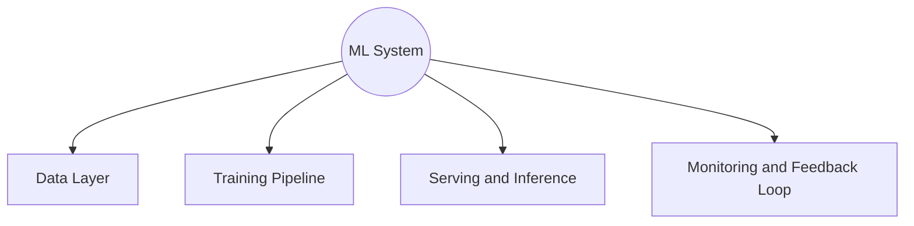
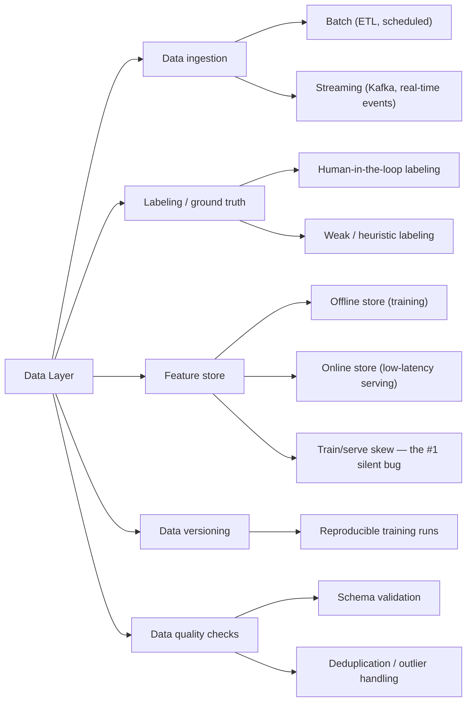
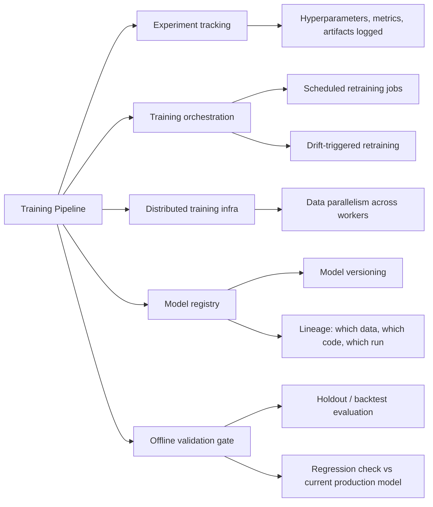
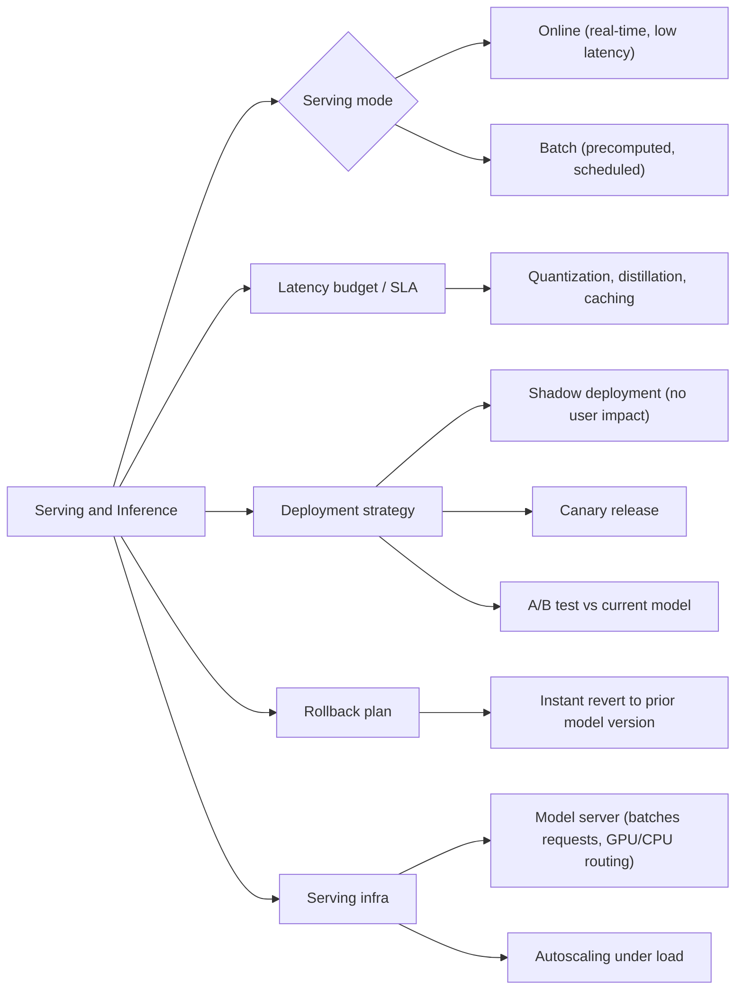
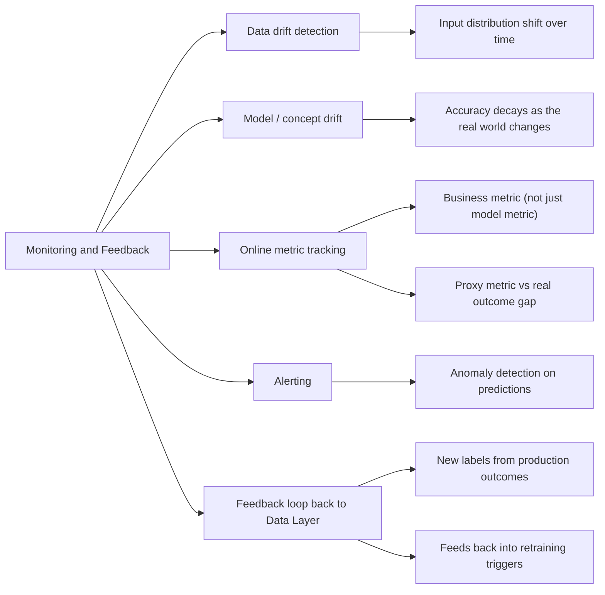

# The ML System Design Mental Model: One Diagram, the Whole Pipeline

Same format as the Android and Go mindmaps — a small overview, then one full-size diagram per branch. This is about the **engineering system around a model** — data, pipelines, serving, monitoring — not the model architecture itself. **ML System** sits in the center; four branches radiate out, roughly in the order data actually flows through a real production system.

## Overview

---

## Branch 1: Data Layer

---

## Branch 2: Training Pipeline

---

## Branch 3: Serving and Inference

---

## Branch 4: Monitoring and Feedback Loop

---

## How the four branches actually connect

This is the part that separates "I can name ML infra buzzwords" from actually having the mental model: **these four branches form a loop, not a pipeline with an end.** Monitoring doesn't just watch the system from the outside — its whole reason for existing is to feed back into the Data Layer (new labels from real outcomes) and the Training Pipeline (drift-triggered retraining), which is exactly what the arrow from Branch 4 back into Branch 1 represents. A system that trains once, deploys once, and never closes that loop isn't really an ML *system* — it's a one-time model export with a REST endpoint bolted on.

The single most common real-world failure point sits at the seam between Branch 1 and Branch 3: **train/serve skew** — the features computed during training (often batch, from a data warehouse) don't exactly match the features computed during live serving (often streaming, from a cache), and the model silently performs worse in production than its offline validation numbers ever suggested, for reasons that have nothing to do with the model itself. This is precisely why a feature store's split between an offline and online store is called out explicitly in Branch 1 rather than treated as a minor implementation detail — it's usually the actual root cause when a model that "tested great" quietly underperforms once it's live.

The deployment strategies in Branch 3 (shadow mode, canary, A/B test) exist for the same underlying reason system design's caching and rollout patterns exist in the HLD cheat sheet — a new model is a new, unproven piece of the system, and the safe move is always to validate it against real traffic with a controlled blast radius before fully trusting it, exactly the same caution a rolling deployment applies to a new code version.

---

*Pairs with the HLD (System Design) cheat sheet in this series — many of the same underlying tradeoffs (caching, latency budgets, rollout strategy, monitoring) reappear here, just applied to a system whose core component happens to be a model instead of a stateless API.*
