# The SQL Flowchart: Decision Tree for Tackling SQL Problems

Same spirit as AlgoMonster's LeetCode flowchart — instead of "which algorithm," this answers "which SQL technique," based on what the problem is actually asking for.

```mermaid
flowchart TD
    Start["What is the problem asking for?"] --> Q1{"Does it need data<br/>from 2+ tables?"}

    Q1 -->|Yes| Q2{"What's the<br/>relationship?"}
    Q1 -->|No, one table| Q6{"Summary per row,<br/>or collapsed groups?"}

    Q2 -->|"Only matching rows<br/>on both sides"| INNER["INNER JOIN"]
    Q2 -->|"All of table A,<br/>matched B if it exists"| LEFT["LEFT JOIN"]
    Q2 -->|"All rows, both sides,<br/>matched where possible"| FULL["FULL OUTER JOIN"]
    Q2 -->|"Every combination,<br/>no matching condition"| CROSS["CROSS JOIN"]
    Q2 -->|"Table joined<br/>to itself"| SELFJ["Self JOIN<br/>(alias table twice)"]
    Q2 -->|"Find rows in A<br/>with NO match in B"| ANTI{"Anti-join pattern"}

    ANTI --> ANTI1["LEFT JOIN B<br/>+ WHERE B.id IS NULL"]
    ANTI --> ANTI2["or NOT EXISTS<br/>(subquery)"]

    Q6 -->|"Per-row result,<br/>keep every row"| Q7{"What kind of<br/>per-row calc?"}
    Q6 -->|"Collapse rows<br/>into group summaries"| GROUPBY["GROUP BY<br/>+ aggregate fn"]

    GROUPBY --> Q8{"Need to filter<br/>the groups?"}
    Q8 -->|Yes, on aggregate| HAVING["HAVING<br/>(filters AFTER grouping)"]
    Q8 -->|Yes, on raw rows| WHERE["WHERE<br/>(filters BEFORE grouping)"]
    Q8 -->|No| GROUPBY

    Q7 -->|"Rank / Top-N<br/>per group"| WINDOW1["Window fn:<br/>RANK/DENSE_RANK/<br/>ROW_NUMBER() OVER(PARTITION BY...)"]
    Q7 -->|"Compare to<br/>prev/next row"| WINDOW2["Window fn:<br/>LAG() / LEAD()"]
    Q7 -->|"Running total /<br/>cumulative sum"| WINDOW3["Window fn:<br/>SUM(...) OVER(ORDER BY...)"]
    Q7 -->|"Group average,<br/>but keep all rows"| WINDOW4["Window fn:<br/>AVG(...) OVER(PARTITION BY...)"]

    Start --> Q3{"Hierarchical or<br/>recursive structure?<br/>(org chart, category tree)"}
    Q3 -->|Yes| RCTE["Recursive CTE<br/>(WITH RECURSIVE)"]

    Start --> Q4{"Reusing the same<br/>subquery logic<br/>multiple times,<br/>or deeply nested?"}
    Q4 -->|Yes| CTE["Use a CTE<br/>(WITH ... AS)"]

    Start --> Q5{"Need to turn<br/>rows into columns?"}
    Q5 -->|Yes| PIVOT["Conditional aggregation:<br/>SUM(CASE WHEN...THEN 1 ELSE 0 END)"]

    Start --> Q9{"Finding duplicates,<br/>or removing them?"}
    Q9 -->|"Find them"| DUPFIND["GROUP BY col<br/>HAVING COUNT(*) > 1"]
    Q9 -->|"Remove them,<br/>keep one"| DUPDEL["DELETE WHERE id NOT IN<br/>(SELECT MIN(id) GROUP BY dupe_col)"]

    Start --> Q10{"Comparing two<br/>result sets?"}
    Q10 -->|"Combine vertically"| SETOP{"Need duplicates<br/>removed?"}
    SETOP -->|Yes| UNION["UNION"]
    SETOP -->|No, keep them| UNIONALL["UNION ALL<br/>(faster, no dedup)"]
    Q10 -->|"Only rows<br/>in BOTH"| INTERSECT["INTERSECT"]
    Q10 -->|"Rows in A,<br/>NOT in B"| EXCEPT["EXCEPT<br/>(or NOT EXISTS —<br/>avoid NOT IN with nullable columns)"]

    Start --> Q11{"Detecting consecutive<br/>values or gaps<br/>in a sequence?"}
    Q11 -->|Yes| GAPS["date - ROW_NUMBER() OVER(ORDER BY date)<br/>= constant for each unbroken run"]

    Start --> Q12{"Query is correct<br/>but SLOW?"}
    Q12 -->|Yes| EXPLAIN["Run EXPLAIN ANALYZE"]
    EXPLAIN --> Q13{"Full table scan<br/>on a filtered/joined column?"}
    Q13 -->|Yes| INDEX["Add an index on<br/>that column"]
    Q13 -->|"No, scan looks fine"| Q14{"Correlated subquery<br/>re-running per row?"}
    Q14 -->|Yes| REWRITE["Rewrite as a JOIN<br/>or window function"]
```

---

## How to actually use this

Same approach as AlgoMonster's version — read the problem statement first, identify which **shape** of question it is, then follow the branch. A few things worth knowing before you start clicking through it:

- **"One table vs. multiple tables" is always the first fork.** If the problem mentions two named entities (employees & managers, orders & customers), you're in JOIN territory before anything else.
- **"Collapse rows vs. keep every row" is the second fork, and it's the one people skip.** This is the single most common miscategorization in real practice — mistaking a "rank within group" problem (keep every row, annotate it) for a "group summary" problem (collapse to one row per group), which sends you toward `GROUP BY` when you actually needed a window function, or vice versa. If the expected output has the **same number of rows as the input**, you almost certainly want a window function. If it has **fewer rows than the input** (one per group), you want `GROUP BY`.
- **`HAVING` vs. `WHERE` is a filtering-timing question, not a stylistic one** — covered in depth in the main SQL cheat sheet's execution-order section, but the short version for this flowchart: if the condition involves an aggregate (`COUNT`, `AVG`, `SUM`), it has to be `HAVING`, because `WHERE` runs before those aggregates exist.
- **Anti-join patterns (`LEFT JOIN ... IS NULL` vs `NOT EXISTS`) are functionally similar but not identical at scale** — `NOT EXISTS` often optimizes better on large tables because the engine can stop as soon as it finds one match, whereas a `LEFT JOIN` followed by a `NULL` check still has to compute the full join first. Worth testing both with `EXPLAIN` on a genuinely large table rather than assuming.
- **The "slow query" branch is deliberately its own separate flowchart entry point**, not fused into the boxes above it — that's a debugging flow, not a query-writing flow. Reach for it after your query is already logically correct and you're optimizing performance, not while you're still figuring out its shape.

---

*Pairs with the SQL cheat sheet in this series — that one covers the syntax and patterns in depth; this is the "which one do I actually reach for" map you follow before writing anything.*
