# The System Design Flowchart: Decision Tree for HLD Interviews

Same idea as the SQL and AlgoMonster flowcharts — instead of "which technique," this answers "which architectural decision," in the order you'd actually need to make them in a real design interview.

```mermaid
flowchart TD
    Start["Given a system design prompt"] --> Q1["Step 1: Clarify requirements<br/>BEFORE designing anything"]

    Q1 --> Q1a{"Functional requirements:<br/>what must it DO?"}
    Q1a --> Q1b{"Non-functional requirements:<br/>scale, latency, consistency needs?"}

    Q1b --> Q2["Step 2: Estimate scale<br/>(back-of-envelope math)"]
    Q2 --> Q2a["Users, requests/sec,<br/>read:write ratio,<br/>data size & growth"]

    Q2a --> Q3{"Read-heavy<br/>or write-heavy?"}

    Q3 -->|"Read-heavy<br/>(reads &gt;&gt; writes)"| R1["Prioritize: caching,<br/>read replicas, CDN"]
    Q3 -->|"Write-heavy<br/>(writes &gt;&gt; reads)"| W1["Prioritize: sharding,<br/>async writes via queue,<br/>write-optimized storage"]
    Q3 -->|"Roughly balanced"| B1["Design for both,<br/>lean on caching first<br/>(cheapest win)"]

    R1 --> Q4
    W1 --> Q4
    B1 --> Q4

    Q4{"Does correctness require<br/>strong consistency?<br/>(money, inventory, auth)"} -->|Yes| CP["Lean CP:<br/>SQL / strongly consistent store,<br/>synchronous replication,<br/>accept some latency"]
    Q4 -->|"No, eventual is fine<br/>(likes, views, feeds,<br/>activity logs)"| AP["Lean AP:<br/>NoSQL / eventually consistent,<br/>async replication,<br/>optimize for availability"]

    CP --> Q5
    AP --> Q5

    Q5{"What's the data's<br/>natural shape?"}
    Q5 -->|"Relational, needs JOINs,<br/>strong schema"| SQL_DB["SQL (Postgres/MySQL)"]
    Q5 -->|"Flexible/evolving schema,<br/>document-like"| DOC_DB["Document store (MongoDB)"]
    Q5 -->|"Simple key -&gt; value,<br/>accessed by ID"| KV_DB["Key-value store<br/>(Redis, DynamoDB)"]
    Q5 -->|"Massive write throughput,<br/>wide-scale horizontal"| WIDE_DB["Wide-column store<br/>(Cassandra)"]
    Q5 -->|"Relationships ARE<br/>the main query"| GRAPH_DB["Graph database<br/>(Neo4j)"]

    SQL_DB --> Q6
    DOC_DB --> Q6
    KV_DB --> Q6
    WIDE_DB --> Q6
    GRAPH_DB --> Q6

    Q6{"Single DB instance<br/>enough for the scale<br/>estimated in Step 2?"}
    Q6 -->|"Yes"| SINGLE["Single primary DB<br/>+ read replicas if read-heavy"]
    Q6 -->|"No — too much<br/>write volume or data"| SHARD{"Choose a<br/>sharding strategy"}

    SHARD -->|"Even, known key<br/>distribution"| HASHSHARD["Hash-based sharding"]
    SHARD -->|"Need range queries<br/>(dates, sorted IDs)"| RANGESHARD["Range-based sharding"]
    SHARD -->|"Data residency /<br/>latency by region"| GEOSHARD["Geographic sharding"]

    SINGLE --> Q7
    HASHSHARD --> Q7
    RANGESHARD --> Q7
    GEOSHARD --> Q7

    Q7{"Any slow, non-critical<br/>work in the request path?<br/>(emails, notifications,<br/>analytics, thumbnails)"}
    Q7 -->|Yes| QUEUE["Move it off the request path:<br/>message queue<br/>+ async worker(s)"]
    Q7 -->|No| Q8

    QUEUE --> Q8

    Q8{"Serving static assets,<br/>or a global user base?"}
    Q8 -->|Yes| CDN["Add a CDN<br/>for static/cacheable content"]
    Q8 -->|No| Q9

    CDN --> Q9

    Q9{"Multiple app server<br/>instances needed?"}
    Q9 -->|Yes| LB{"Route by content<br/>(path/header),<br/>or just spread load?"}
    LB -->|"Just spread load"| LB4["Layer 4 load balancer"]
    LB -->|"Route by path/header"| LB7["Layer 7 load balancer"]
    Q9 -->|No, one instance is fine| Q10

    LB4 --> Q10
    LB7 --> Q10

    Q10{"Are app servers storing<br/>per-user session state<br/>locally?"}
    Q10 -->|Yes — fix this| STATELESS["Externalize session state:<br/>Redis / shared store, or JWT.<br/>Keep servers stateless."]
    Q10 -->|"No, already stateless"| Q11

    STATELESS --> Q11

    Q11{"Is the system exposed<br/>to abusive/runaway traffic,<br/>or third-party clients?"}
    Q11 -->|Yes| RATELIMIT["Add rate limiting<br/>(token bucket, typically)"]
    Q11 -->|No| Q12

    RATELIMIT --> Q12

    Q12{"Does scope justify<br/>splitting into<br/>independent services?"}
    Q12 -->|"Yes — clear independent<br/>scaling/ownership needs"| MICRO["Microservices,<br/>each own DB where sensible,<br/>service discovery, API gateway"]
    Q12 -->|"No — premature<br/>at this stage"| MONO["Stay a monolith (or a few<br/>coarse services). Simpler,<br/>split later if pain shows up."]

    MICRO --> Done["Draw the full diagram,<br/>state your tradeoffs out loud,<br/>revisit under new constraints<br/>if the interviewer changes them"]
    MONO --> Done
```

---

## How to actually use this

The order of the branches above **is** the interview flow, not just a reference to jump around in — each answer genuinely constrains the ones after it, the same way choosing SQL vs. NoSQL upstream shapes whether sharding even makes sense downstream.

- **Step 1 is not optional and it's the most commonly skipped step under interview pressure.** Jumping straight to "I'll use Kafka and Cassandra" before clarifying whether the system needs 1,000 users or 100 million is the single most common way candidates lose points early — the whole rest of the flowchart is meaningless without the scale estimate from Step 2 grounding it.
- **Read-heavy vs. write-heavy (Q3) is the fork that decides your entire caching and replication story** — get this wrong and you'll spend the interview optimizing for a bottleneck the system doesn't actually have.
- **The CP vs. AP fork (Q4) is where most candidates either over-engineer or under-engineer.** Defaulting to "strong consistency everywhere, just to be safe" is a common overcorrection — it's a real latency and complexity cost you're paying for a guarantee most features (feeds, view counts, recommendations) never actually needed. Conversely, treating a payments or inventory system as eventually-consistent "for scale" is the inverse mistake, and interviewers will absolutely ask about it if you gloss over it.
- **Sharding (Q6) should be visibly a last resort, not a default.** A strong answer explicitly says "a single primary with read replicas comfortably handles this scale, I'd only shard once we outgrow that" — reaching for sharding immediately, before the scale numbers actually justify it, reads as pattern-matching rather than reasoning.
- **Microservices vs. monolith (Q12) is deliberately the very last fork**, not the first architectural decision — same caution as the HLD cheat sheet's own closing point: most real systems (and most strong interview answers) start as a monolith or a small number of coarse services, and only split further when a specific, nameable pressure (independent scaling, independent team ownership, independent deploy cadence) actually justifies the real complexity cost of doing so.
- **`Done` isn't actually the end.** A real interview will change a constraint on you mid-conversation ("now assume 100x the traffic," "now assume it needs to work offline") specifically to see whether you re-walk the relevant branches or just defend your original diagram. Being willing to say "given that new constraint, I'd actually reconsider X" is a stronger signal than getting the first pass perfectly right.

---

*Pairs with the HLD (System Design) cheat sheet in this series — that one covers the vocabulary and tradeoffs in depth; this is the "what do I decide, and in what order" map you follow when the clock actually starts.*
